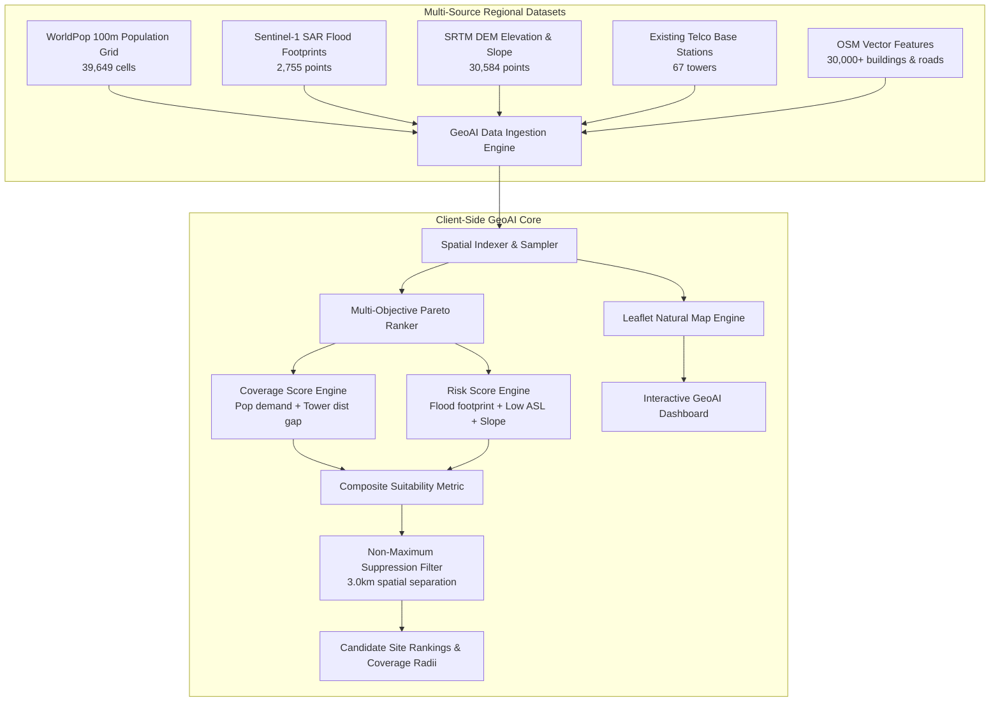

# 📡 P.I.N.T.A.R.

**Predictive Intelligence for Network Tower Allocation & Risk-assessment**


Developed by **Team Bolehla** (HACK-MY-090) for the **ASEAN GeoAI Fusion 2026 Hackathon**.

P.I.N.T.A.R. is an enterprise-grade GeoAI platform scaled to optimize telecommunications tower allocation and climate resilience across the entire region of **Kuala Selangor, Selangor, Malaysia**. It identifies optimal network tower deployment candidate locations by fusing multi-variate geospatial datasets (WorldPop demographic grid, Sentinel-1 SAR flood risk footprints, SRTM terrain elevation & slope, and existing telecom tower base stations) and executing a multi-objective Pareto optimization engine directly in the browser.

---

## 🌐 Live Demo & Execution

Open `index.html` in any modern web browser — zero compilation or heavy backend framework required.

```bash
# Serve locally via Python
python -m http.server 8000

# Or serve via Node.js / npx
npx serve .
```

Access the dashboard at `http://localhost:8000`.

---

## 🗺️ Key Features & Regional GIS Capabilities

| Feature | Description |
|---|---|
| **Natural Basemaps** | High-resolution Esri World Satellite Imagery, Topographic Terrain, Dark Mode & OpenStreetMap |
| **WorldPop Grid (2026)** | 39,649 high-density demographic grid cells covering 95,359 residents across Kuala Selangor |
| **Existing Telco Network** | 67 existing telecommunication base stations & masts for gap analysis and overlap prevention |
| **Sentinel-1 Flood Footprints** | 2,755 active SAR flood risk points mapped for climate resilience planning |
| **SRTM DEM Terrain Elevation** | 30,584 elevation (ASL) and slope points for Line-of-Sight (LOS) signal optimization |
| **Infrastructure & Buildings** | OSM building footprints & critical facilities (schools, clinics, police, fire stations) |
| **Multi-Objective Optimizer** | Spatial grid search balancing population attraction, coverage gaps, terrain, and flood hazards |
| **Click-to-Evaluate Tooltip** | Instant custom coordinate evaluation anywhere on the map with real-time suitability scoring |
| **Analytics Dashboard** | Interactive regional elevation histogram + risk classification doughnut chart |

---

## 🏗️ System Architecture & Data Pipeline



---

## 📁 Project Structure

```
PINTAR/
├── index.html                           # Main application HTML structure
├── style.css                            # Modern dark-mode glassmorphism design system
├── app.js                               # Core GeoAI engine, layer renderers & spatial optimizer
├── README.md                            # Complete regional system documentation
├── Datasets/
│   ├── WorldPop Population/
│   │   └── WorldPop_Malaysia_Population_CSV.csv  # 39,649 population grid cells (95,359 residents)
│   ├── Existing Telco Tower/
│   │   └── Telco Network.json                    # 67 existing telco base stations & masts
│   ├── Flood Footprints/
│   │   └── Sentinel1_Flood_Footprints_CSV.csv    # 2,755 Sentinel-1 SAR flood hazard points
│   ├── DEM/
│   │   └── SRTM_DEM_Slope_Points_CSV.csv         # 30,584 elevation & slope terrain points
│   └── OSM/
│       ├── Buildings_With_Geom.json              # Building footprints
│       ├── Roads_With_Geom.json                  # Vector road network
│       └── Critical Infrastucture.json           # Schools, clinics, police, fire stations
└── Bolehla/                                    # Submission & presentation deliverables
    ├── HACK-MY-090_SLDK_v01.pptx              # Solution Design Kit
    └── HACK-HACK_MY_090_PDGS_v01.pptx         # Pitch Deck
```

---

## 🔬 Multi-Objective Optimization Methodology

Each regional grid candidate location $(x, y)$ across Kuala Selangor is evaluated via a balanced dual-objective heuristic model:

1. **Coverage & Demand Score ($S_{\text{coverage}}$):**
   - **Population Attraction:** Sum of WorldPop population volume within $2.5\,\text{km}$ radius.
   - **Coverage Gap Bonus:** Rewards candidates located $>2.5\,\text{km}$ away from existing base stations; penalizes redundant overlap ($<1.2\,\text{km}$).
   - **Infrastructure Attraction:** Proximity to critical community facilities and residential clusters.

2. **Risk Mitigation Score ($S_{\text{risk}}$):**
   - **Flood Penalty:** Active penalty if candidate falls within $1.0\,\text{km}$ buffer of Sentinel-1 flood footprints.
   - **Terrain Vulnerability:** Penalizes low-lying coastal terrain ($<12\,\text{m}$ ASL) and steep unstable slopes ($>12^\circ$).

$$\text{Composite Score} = 0.55 \times S_{\text{coverage}} + 0.45 \times (100 - S_{\text{risk}})$$

Candidate sites are spatially filtered using **Non-Maximum Suppression (NMS)** with a $3.0\,\text{km}$ minimum inter-tower separation radius to ensure equitable telecom distribution across all mukims (Bestari Jaya, Jeram, Ijok, Tanjung Karang, Api-Api, and Kuala Selangor town).

---

## 📊 Regional Dataset Summary (Kuala Selangor)

| Dataset | Provider | Feature Type | Record Count |
|---|---|---|---|
| **WorldPop Population Grid** | WorldPop / GHSL | Spatial CSV | 39,649 cells (95,359 pop) |
| **Existing Telco Network** | OpenStreetMap / Overpass | GeoJSON Nodes | 67 base stations / masts |
| **Sentinel-1 Flood Footprints** | ESA Copernicus SAR | Spatial CSV | 2,755 hazard footprints |
| **SRTM DEM Terrain & Slope** | NASA SRTM (30m) | Spatial CSV | 30,584 points |
| **Building Footprints** | OpenStreetMap | GeoJSON Polygons | ~31,200 footprints |
| **Road Network** | OpenStreetMap | GeoJSON Lines | ~650 segments |
| **Critical Infrastructure** | OpenStreetMap | GeoJSON Nodes | 88 facilities |

---

## 👥 Team Bolehla

ASEAN GeoAI Fusion 2026 Hackathon — Malaysia Track (**HACK-MY-090**)

---

## 📜 License

This project was developed for the ASEAN GeoAI Fusion 2026 Hackathon. OpenStreetMap data is licensed under ODbL; Sentinel-1 SAR data courtesy of Copernicus Open Access Hub; WorldPop datasets licensed under CC BY 4.0; SRTM elevation data courtesy of NASA JPL.

